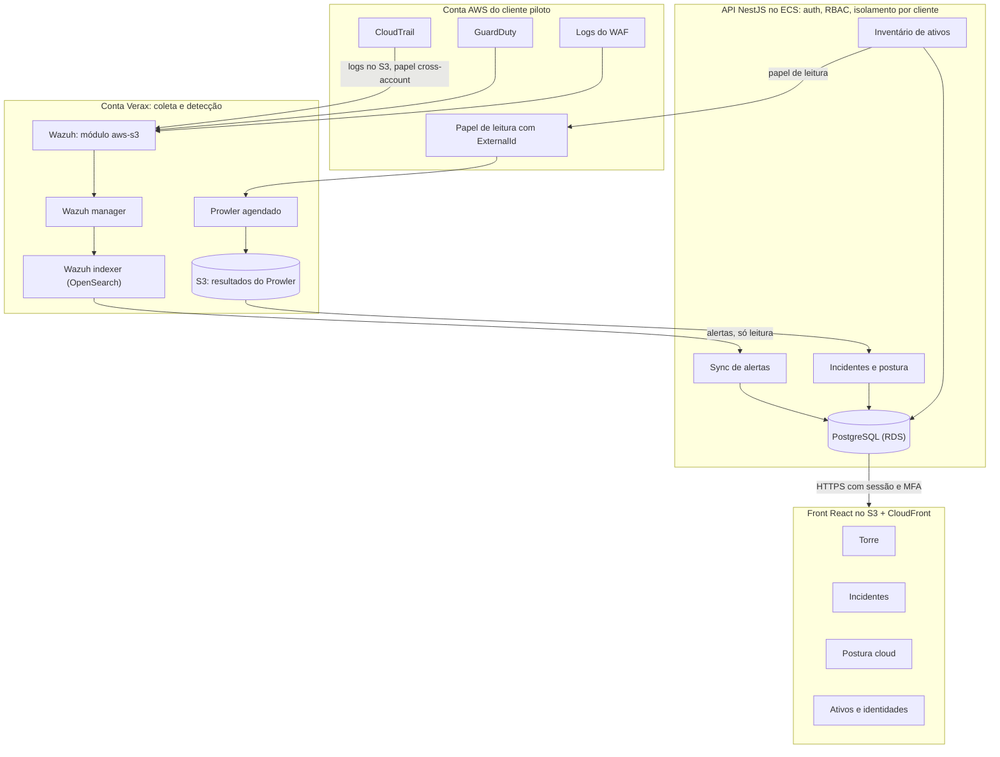
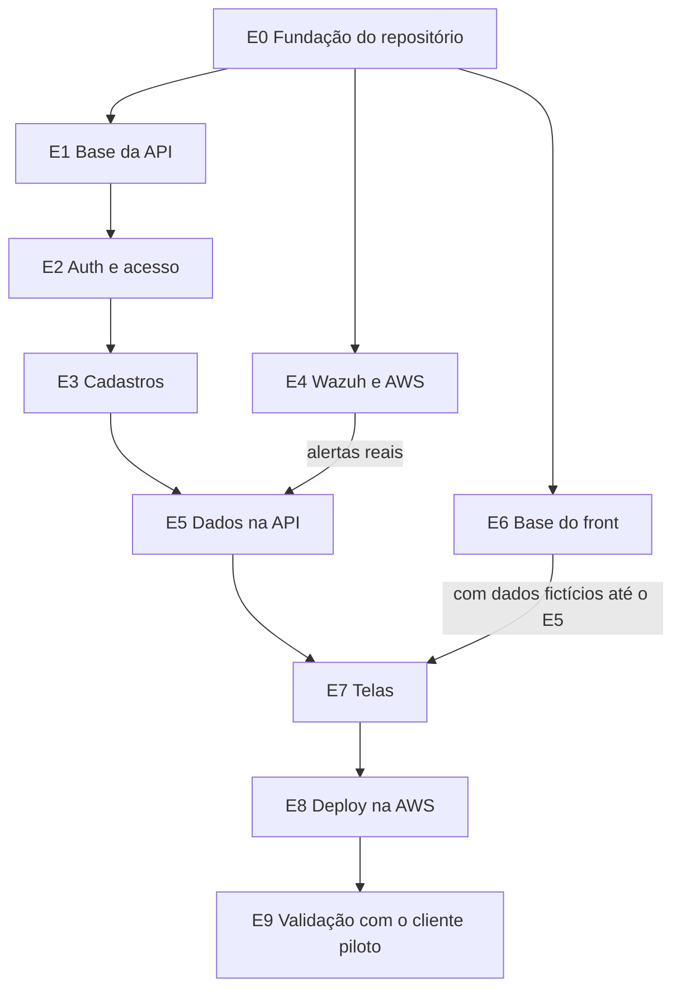

# Verax Control: plano do painel MVP

Documento único com o plano, as regras e o backlog do painel. É a fonte da verdade do projeto até as tasks irem para o Jira. Sugestão: salvar no repositório como `docs/PLANO.md`.

---

## Parte 1: instruções para o modelo

Você é o agente de desenvolvimento do **Verax Control**, um painel de segurança para empresas com operação em nuvem. Você trabalha dentro do VS Code, recebendo uma task por vez deste documento. Siga estas instruções em todas as interações.

### Como trabalhar

1. **Uma task por vez.** O usuário vai pedir algo como "execute a T3.1". Faça só essa task. Nunca comece outra, nem "aproveite para já fazer" algo de outra task. Se perceber algo útil fora do escopo, apenas sugira no final.
2. **Antes de escrever código:**
   - Leia este documento, em especial a task pedida, as regras de segurança e a estrutura do repositório.
   - Confirme que as tasks listadas em "Depende de" estão concluídas no código. Se não estiverem, pare e avise.
   - Responda com seu plano em até 5 linhas (arquivos que vai criar ou alterar e a abordagem) e **espere o OK do usuário**.
3. **Nunca presuma decisões.** Se algo não estiver definido neste documento (biblioteca, nome, valor, regra de negócio, comportamento de tela), pare e pergunte. Se a task tiver uma pendência aberta (campo "Pendência"), pergunte ao usuário a decisão antes de começar.
4. **Escopo de arquivos.** Mexa só nos arquivos necessários para a task. Mudanças em `infra/`, `.github/`, no módulo `auth` ou no arquivo de regras do agente devem ser destacadas na resposta, porque o usuário revisa linha a linha.
5. **Dependências.** Antes de instalar qualquer pacote, informe nome, versão fixa e motivo, e espere o OK.
6. **Atalhos inseguros são proibidos.** Se um erro só se resolveria desligando TLS, CSRF, abrindo CORS, fazendo downgrade de biblioteca ou expondo segredo, pare e explique o problema em vez de aplicar o atalho.
7. **Idioma.** Respostas ao usuário e textos de interface em português do Brasil. Código, nomes de arquivos, módulos, variáveis e tabelas em inglês, seguindo a estrutura de pastas deste documento.
8. **Padrão entre módulos.** A primeira implementação de cada tipo vira o modelo (por exemplo, o módulo `tenants` para CRUDs da API). Nas tasks seguintes do mesmo tipo, siga o padrão existente em vez de criar um novo.
9. **Este documento.** Não edite este arquivo. A única exceção é marcar o campo "Status" de uma task como concluída, e só quando o usuário confirmar.

### Formato da resposta ao terminar uma task

Ao final de toda task, responda com:

- **Arquivos criados e alterados** (lista)
- **Dependências novas** e o motivo de cada uma
- **Testes executados** e o resultado
- **Checklist da definição de pronto**, item a item
- **O que o usuário precisa testar manualmente**
- **Riscos, dúvidas ou sugestões** fora do escopo

### Regras de segurança obrigatórias

Estas regras valem para todo código do projeto. Nenhuma task autoriza quebrá-las.

1. **Banco:** só Prisma com parâmetros. Proibido `$queryRawUnsafe` e qualquer SQL ou consulta ao OpenSearch montada por concatenação de texto vindo do usuário.
2. **Segredos:** nunca no código e nunca no front. No Vite, toda variável `VITE_` vai para o navegador. No front, a única variável permitida é a URL pública da API.
3. **Autorização:** sempre na API, em todo endpoint, com guard de papel e filtro de cliente. Esconder botão no front é só UX, nunca segurança. Endpoint sem permissão declarada é negado por padrão.
4. **Isolamento por cliente:** toda consulta de dado de cliente filtra pelo `tenantId` da sessão, nunca por um id vindo do request. Todo módulo com dado de cliente tem teste negativo: usuário do cliente A não lê nem altera nada do cliente B.
5. **Nada de atalho inseguro:** proibido `rejectUnauthorized: false`, `NODE_TLS_REJECT_UNAUTHORIZED=0`, desligar CSRF, CORS com `*`, ou downgrade de biblioteca para resolver erro.
6. **Entrada externa é não confiável:** inclui requests, alertas do Wazuh, eventos da AWS, resultados do Prowler e saída de LLM. Validar com schema antes de usar ou gravar. Nunca `yaml.load` inseguro, nunca `eval`, nunca desserializar dado externo sem validação.
7. **Logs:** nunca registrar senha, token, cookie, header `Authorization`, segredo da AWS ou payload bruto com dado pessoal. Usar sempre o logger com redaction (T1.1).
8. **Dependências:** versão fixa, justificativa e aprovação do usuário. Pacote novo passa pelo Dependency Review no CI.
9. **Erros:** mensagem genérica para o usuário final; detalhe só no log interno.
10. **Criptografia e sessão:** nunca implementar hash de senha, token, sessão ou MFA "do zero". Usar a biblioteca de autenticação definida (Better Auth).

### Definição de pronto (toda task)

- [ ] Critérios de aceite da task atendidos
- [ ] Testes passando, incluindo o teste negativo de acesso quando houver dado de cliente
- [ ] Lint e checagem de tipos sem erros
- [ ] Nenhuma dependência nova sem justificativa e aprovação
- [ ] Nenhuma das regras de segurança quebrada
- [ ] Resposta final no formato acima

---

## Parte 2: o plano

### Contexto do produto

O Verax Control é um painel de segurança para empresas cloud-first de 20 a 300 pessoas. Ferramentas open source (Wazuh, Prowler) fazem a coleta e a detecção; a API própria transforma alertas em decisões; o painel mostra, em português claro, se está tudo bem e o que o gestor precisa decidir. O MVP é validado com dados reais da conta AWS do cliente piloto.

Princípio de UX: **em 10 segundos, o gestor sabe se está tudo bem e o que precisa decidir.** Decisão antes de dado, um semáforo em vez de vinte números, português de gente em vez de código de regra.

### Decisões tomadas

| Tema | Decisão |
| --- | --- |
| Estrutura do código | Monorepo com front e API separados |
| API | Node.js com NestJS |
| Banco e ORM | PostgreSQL com Prisma |
| Autenticação | Better Auth dentro da API, com MFA obrigatório |
| Front | React + Vite (SPA atrás de login) |
| Acesso dos clientes | Domínio único com login; o cliente é identificado pelo usuário logado |
| Fonte de dados | Wazuh desde o início |
| Wazuh | EC2 single-node com Docker em sa-east-1 |
| Hospedagem | AWS sa-east-1 |
| Dados para validação | Conta AWS real do cliente piloto, via conector |
| Telas do MVP | Torre, Incidentes e achados, Postura cloud, Ativos e identidades, além de login, usuários e clientes |
| Backlog | Jira em site Atlassian próprio da Verax; este documento é a fonte até lá |
| Desenvolvimento | Vibe coding no VS Code com Opus 5.5, uma task por prompt |

### Arquitetura do MVP

A API é a única peça que conversa com tudo. O front nunca acessa Wazuh, OpenSearch nem AWS: só chama a API com sessão autenticada.



Os alertas do Wazuh são copiados para o PostgreSQL pelo sync, porque é lá que ficam os estados humanos ("legítimo", "resolvido", comentários) e o vínculo com o cliente. O OpenSearch continua guardando o evento bruto para consulta e detalhe.

**Ponto crítico:** no MVP há um Wazuh só para todos os clientes. O vínculo entre alerta e cliente vem do ID da conta AWS presente no alerta (T5.2), e esse filtro não pode falhar.

### Estrutura do repositório

```
verax-control/
├── apps/
│   ├── api/                 # NestJS
│   │   ├── prisma/          # schema.prisma, migrations, seed
│   │   └── src/
│   │       ├── common/      # guards, filtros de erro, logger, auditoria
│   │       ├── auth/        # Better Auth, MFA, sessão
│   │       ├── tenants/     # um módulo por domínio
│   │       ├── users/
│   │       ├── cloud-accounts/
│   │       ├── protected-resources/
│   │       ├── alert-exceptions/
│   │       ├── indexer/     # cliente do OpenSearch (só leitura)
│   │       ├── findings/    # achados
│   │       ├── incidents/
│   │       ├── posture/
│   │       ├── assets/
│   │       └── tower/       # resumo da Torre
│   └── web/                 # React + Vite
│       └── src/
│           ├── components/  # design system
│           ├── features/    # uma pasta por tela
│           ├── lib/         # cliente HTTP, query client
│           └── routes/
├── packages/
│   └── shared/              # tipos e schemas compartilhados entre API e front
├── infra/
│   ├── terraform/           # conta Verax
│   ├── cloudformation/      # template do conector do cliente
│   └── wazuh/               # docker-compose e configs do Wazuh
├── docs/
│   └── PLANO.md             # este documento
└── .github/workflows/       # CI (depende da pendência 1)
```

Cada módulo da API segue o mesmo formato: controller, service, DTOs e testes. O tipo de cada dado (achado, incidente, ativo) é definido uma vez em `packages/shared` e usado pela API e pelo front.

### Ordem de execução



- Depois do E0, três trilhas andam em paralelo: API (E1 a E3), infra (E4) e front (E6).
- A **T9.1 (autorização formal do cliente piloto) precisa estar resolvida antes da T4.4**, que conecta a conta real.
- O front pode avançar com dados fictícios tipados a partir de `packages/shared` antes do E5 ficar pronto.

---

## Parte 3: backlog

Formato de cada task: status, dependências, pendência de decisão (quando houver) e critérios de aceite. Total: 67 tasks em 10 épicos.

### Épico 0: fundação do repositório

Antes da primeira regra de negócio, o projeto já bloqueia segredo vazado, dependência vulnerável e código inseguro.

#### T0.1 Criar o monorepo
- **Status:** [ ] pendente
- **Depende de:** nenhuma
- **Critérios de aceite:**
  - pnpm workspaces com `apps/api` (NestJS vazio), `apps/web` (Vite + React + TypeScript vazio) e `packages/shared`
  - Scripts `dev`, `build`, `test` e `lint` na raiz
  - TypeScript strict nos três pacotes

#### T0.2 Escrever o arquivo de regras do agente
- **Status:** [ ] pendente
- **Depende de:** T0.1
- **Pendência:** 2 (o nome do arquivo depende da extensão usada no VS Code)
- **Critérios de aceite:**
  - Contém as instruções da Parte 1 deste documento: modo de trabalho, regras de segurança, definição de pronto e formato de resposta
  - Contém a estrutura de pastas e as convenções de módulo
  - Aponta para `docs/PLANO.md` como fonte do backlog

#### T0.3 Lint, formatação e pre-commit
- **Status:** [ ] pendente
- **Depende de:** T0.1
- **Critérios de aceite:**
  - ESLint e Prettier configurados nos três pacotes
  - Regras que proíbem `$queryRawUnsafe`, `eval` e `rejectUnauthorized: false`
  - Hook de pre-commit rodando Gitleaks e lint

#### T0.4 Ambiente local com Docker
- **Status:** [ ] pendente
- **Depende de:** T0.1
- **Critérios de aceite:**
  - `docker-compose` com PostgreSQL para desenvolvimento
  - `.env.example` sem valores reais; `.env` no `.gitignore`
  - A API não sobe se faltar variável obrigatória (validação de configuração na inicialização)

#### T0.5 CI de segurança
- **Status:** [ ] pendente
- **Depende de:** T0.3
- **Pendência:** 1 (onde o repositório fica hospedado)
- **Critérios de aceite:**
  - Pipeline em PR e push: lint, tipos, testes, Semgrep, Gitleaks, Trivy fs e OSV-Scanner
  - Actions de terceiros fixadas por SHA
  - Permissões mínimas por padrão (`contents: read`)
  - Falha em qualquer etapa bloqueia o merge

#### T0.6 Dependabot e Dependency Review
- **Status:** [ ] pendente
- **Depende de:** T0.5
- **Pendência:** 1
- **Critérios de aceite:**
  - Atualização semanal automática para npm e para as actions do CI
  - Dependency Review como check obrigatório no PR
  - Branch `main` protegida, sem push direto

### Épico 1: base da API

Peças transversais que todo módulo vai usar. Existindo antes dos CRUDs, elas são reaproveitadas em vez de reinventadas.

#### T1.1 Prisma, health check e logger
- **Status:** [ ] pendente
- **Depende de:** T0.4
- **Critérios de aceite:**
  - Prisma conectado ao PostgreSQL local, com a primeira migration
  - Endpoint `GET /health`
  - Logger estruturado (pino) com redaction de `authorization`, `cookie`, `password`, `token` e segredos AWS
  - Teste provando que esses campos são removidos do log

#### T1.2 Padrões de API
- **Status:** [ ] pendente
- **Depende de:** T1.1
- **Critérios de aceite:**
  - Prefixo `/v1` em todas as rotas
  - Validação global de entrada que rejeita campos desconhecidos
  - Filtro de erro que devolve mensagem genérica e loga o detalhe
  - Paginação padrão reutilizável
  - Documentação OpenAPI disponível só em ambiente de desenvolvimento
  - Headers de segurança (helmet)

#### T1.3 Trilha de auditoria
- **Status:** [ ] pendente
- **Depende de:** T1.2
- **Critérios de aceite:**
  - Tabela `AuditLog` com quem, cliente, ação, recurso, estado anterior, estado novo, data e IP
  - Interceptor que registra toda operação de escrita
  - Nenhum endpoint permite editar ou apagar registros de auditoria

### Épico 2: autenticação e acesso

O épico mais sensível do painel. O usuário revisa todos os diffs deste épico linha a linha. Nada de criptografia ou sessão escrita do zero (regra 10).

#### T2.1 Login com Better Auth
- **Status:** [ ] pendente
- **Depende de:** T1.3
- **Critérios de aceite:**
  - Login e logout com e-mail e senha
  - Sessão em cookie `HttpOnly`, `Secure` e `SameSite`
  - Hash de senha feito pela própria biblioteca
  - Tabelas de usuário e sessão no Prisma

#### T2.2 MFA obrigatório
- **Status:** [ ] pendente
- **Depende de:** T2.1
- **Critérios de aceite:**
  - Cadastro de TOTP no primeiro login e verificação em todo login
  - Códigos de recuperação
  - Usuário sem MFA cadastrado não acessa nada além da tela de cadastro do MFA

#### T2.3 Proteções de login e sessão
- **Status:** [ ] pendente
- **Depende de:** T2.1
- **Critérios de aceite:**
  - Limite de tentativas por IP e por usuário, com bloqueio temporário
  - Proteção CSRF (checagem de origem e token)
  - CORS liberado só para o domínio do painel
  - Expiração de sessão por inatividade
  - Eventos de login (sucesso e falha) gravados na auditoria

#### T2.4 Papéis e permissões
- **Status:** [ ] pendente
- **Depende de:** T2.1
- **Critérios de aceite:**
  - Papéis `admin_verax`, `admin_cliente`, `analista_cliente` e `leitura`
  - Guard que exige papel declarado por endpoint
  - Endpoint sem permissão declarada é negado por padrão

#### T2.5 Isolamento por cliente
- **Status:** [ ] pendente
- **Depende de:** T2.4
- **Critérios de aceite:**
  - O `tenantId` vem sempre da sessão
  - Extensão do Prisma que aplica o filtro de cliente em toda consulta de dado de cliente
  - Só `admin_verax` pode trocar de cliente, e a troca fica registrada na auditoria
  - Teste negativo: usuário do cliente A não lê nem altera dado do cliente B

#### T2.6 Convite e redefinição de senha
- **Status:** [ ] pendente
- **Depende de:** T2.5
- **Pendência:** 3 (provedor de e-mail)
- **Critérios de aceite:**
  - Convite por e-mail com link de uso único e validade curta
  - Redefinição de senha com o mesmo padrão
  - Resposta idêntica para e-mail existente ou inexistente (não revela usuários)

### Épico 3: cadastros

Cada task é o CRUD completo de um módulo na API: model Prisma, migration, endpoints, validação, permissões, auditoria e testes. Sem tela. A T3.1 é o modelo para as demais.

#### T3.1 CRUD de Clientes
- **Status:** [ ] pendente
- **Depende de:** T2.5
- **Critérios de aceite:**
  - Campos: nome, CNPJ, status, plano, contato de escalonamento
  - Só `admin_verax` cria, edita e desativa
  - Exclusão lógica
  - Testes de permissão

#### T3.2 CRUD de Usuários do cliente
- **Status:** [ ] pendente
- **Depende de:** T3.1, T2.6
- **Critérios de aceite:**
  - Listar, convidar, alterar papel e desativar
  - `admin_cliente` gerencia só usuários do próprio cliente
  - Ninguém altera o próprio papel
  - Teste negativo entre clientes

#### T3.3 CRUD de Contas cloud
- **Status:** [ ] pendente
- **Depende de:** T3.1
- **Critérios de aceite:**
  - Campos: provedor, ID da conta AWS, regiões, ARN do papel de leitura, status
  - O `ExternalId` é gerado pelo sistema e nunca aceito do request
  - Nenhuma chave de acesso é armazenada
  - Um ID de conta não pode pertencer a dois clientes

#### T3.4 CRUD da Lista de proteção
- **Status:** [ ] pendente
- **Depende de:** T3.3
- **Critérios de aceite:**
  - Recursos e identidades que nunca recebem ação automática: tipo, identificador, motivo, quem incluiu
  - Escopo por cliente
  - Todas as alterações auditadas

#### T3.5 CRUD de Exceções de alerta
- **Status:** [ ] pendente
- **Depende de:** T3.3
- **Critérios de aceite:**
  - Campos: regra do Wazuh, condição (usuário, IP ou recurso), motivo, validade opcional, autor
  - Usadas pelo sync (T5.3) para marcar achados como esperados
  - Escopo por cliente
  - Todas as alterações auditadas

### Épico 4: infra Wazuh e conexão com a AWS

Toda infraestrutura é código: Terraform na conta Verax, CloudFormation no template do cliente.

#### T4.1 Terraform base da conta Verax
- **Status:** [ ] pendente
- **Depende de:** T0.1
- **Critérios de aceite:**
  - State remoto em S3, com lock e criptografia
  - VPC em sa-east-1 com subnets privadas e públicas
  - Security groups mínimos e tags padrão
  - Nada criado manualmente pelo console

#### T4.2 EC2 do Wazuh com Docker
- **Status:** [ ] pendente
- **Depende de:** T4.1
- **Critérios de aceite:**
  - Wazuh single-node (manager, indexer, dashboard) em subnet privada, sem IP público
  - Acesso só por SSM Session Manager
  - Disco criptografado
  - Certificados TLS gerados e nunca desligados
  - Todas as senhas padrão trocadas e guardadas no Secrets Manager

#### T4.3 Template do conector do cliente
- **Status:** [ ] pendente
- **Depende de:** T4.1
- **Critérios de aceite:**
  - CloudFormation que cria na conta do cliente um papel só de leitura com `ExternalId`, confiando apenas na conta Verax
  - Garante CloudTrail multi-região gravando em S3
  - Inclui a exportação de findings do GuardDuty para S3
  - Dá leitura aos buckets de logs
  - README explicando como rodar

#### T4.4 CloudTrail no Wazuh
- **Status:** [ ] pendente
- **Depende de:** T4.2, T4.3, T9.1
- **Critérios de aceite:**
  - Módulo `aws-s3` lendo o CloudTrail da conta conectada via papel cross-account
  - Alertas no indexer com o ID da conta de origem
  - Só conectar a conta do cliente piloto depois da T9.1 concluída

#### T4.5 GuardDuty no Wazuh
- **Status:** [ ] pendente
- **Depende de:** T4.4
- **Critérios de aceite:**
  - Módulo `aws-s3` do tipo GuardDuty lendo os findings exportados
  - Findings visíveis no indexer

#### T4.6 Logs do WAF no Wazuh
- **Status:** [ ] pendente
- **Depende de:** T4.4
- **Critérios de aceite:**
  - Logs do AWS WAF gravados em S3
  - Módulo `aws-s3` do tipo WAF lendo
  - Requisições bloqueadas visíveis no indexer

#### T4.7 Prowler agendado
- **Status:** [ ] pendente
- **Depende de:** T4.3
- **Critérios de aceite:**
  - Tarefa agendada (ECS Fargate + EventBridge Scheduler) que assume o papel de leitura e roda o Prowler por conta
  - Resultado em JSON-OCSF num bucket da Verax, separado por cliente e data

#### T4.8 Acesso só leitura ao indexer
- **Status:** [ ] pendente
- **Depende de:** T4.2
- **Critérios de aceite:**
  - Usuário do OpenSearch com permissão apenas de leitura nos índices de alertas
  - Senha no Secrets Manager
  - Acesso liberado só a partir da rede da API
  - Validação TLS com a CA do Wazuh

#### T4.9 Retenção e backup
- **Status:** [ ] pendente
- **Depende de:** T4.2
- **Pendência:** 6 (prazo de retenção)
- **Critérios de aceite:**
  - Política que apaga alertas após o prazo definido
  - Snapshot diário do indexer em S3
  - Teste de restauração documentado

### Épico 5: dados na API

Aqui o Wazuh vira produto. A T5.2 é o ponto crítico de segurança do MVP.

#### T5.1 Módulo do indexer
- **Status:** [ ] pendente
- **Depende de:** T4.8, T1.2
- **Critérios de aceite:**
  - Cliente do OpenSearch com credencial lida do Secrets Manager, TLS validado e timeout
  - Consultas montadas com o query DSL estruturado, nunca com texto vindo do usuário
  - Somente leitura

#### T5.2 Vínculo entre alerta e cliente
- **Status:** [ ] pendente
- **Depende de:** T5.1, T3.3
- **Critérios de aceite:**
  - Função única que descobre o cliente pelo ID da conta presente no alerta, usando o cadastro da T3.3
  - Alerta de conta não cadastrada vai para uma fila "sem dono", visível só para `admin_verax`
  - Testes com alertas de duas contas de clientes diferentes

#### T5.3 Sync de alertas para achados
- **Status:** [ ] pendente
- **Depende de:** T5.2, T3.5
- **Critérios de aceite:**
  - Job periódico que lê alertas novos (cursor por data)
  - Valida o formato antes de gravar
  - Grava como `Finding` no PostgreSQL com severidade, regra, ativo e ID do evento original
  - Idempotente: rodar duas vezes não duplica
  - Aplica as exceções da T3.5

#### T5.4 Achados: lista e detalhe
- **Status:** [ ] pendente
- **Depende de:** T5.3
- **Critérios de aceite:**
  - Listagem com filtros por severidade, status, período e conta
  - Detalhe com o evento bruto buscado no indexer
  - Teste de isolamento por cliente

#### T5.5 Achados: status e comentário
- **Status:** [ ] pendente
- **Depende de:** T5.4
- **Critérios de aceite:**
  - Mudar status: novo, em análise, legítimo, resolvido
  - Comentar
  - Ao marcar "legítimo", oferecer criar exceção (T3.5)
  - Tudo auditado

#### T5.6 Agrupamento em incidentes
- **Status:** [ ] pendente
- **Depende de:** T5.3
- **Critérios de aceite:**
  - Regra v1: achados do mesmo usuário, chave, IP ou recurso numa janela de tempo viram um incidente
  - Nota de risco de 0 a 100 (severidade, criticidade e quantidade)
  - Táticas MITRE ATT&CK quando o Wazuh informar

#### T5.7 Incidentes: lista, detalhe e status
- **Status:** [ ] pendente
- **Depende de:** T5.6
- **Critérios de aceite:**
  - Listagem ordenada por nota
  - Detalhe com linha do tempo dos achados e ativos envolvidos
  - Mudança de status e de responsável
  - Tudo auditado

#### T5.8 Postura a partir do Prowler
- **Status:** [ ] pendente
- **Depende de:** T4.7, T3.3
- **Critérios de aceite:**
  - Job que lê o resultado do Prowler no S3 e grava as checagens por conta
  - Nota de postura de 0 a 100
  - Histórico por data para mostrar evolução
  - Endpoints de nota e de achados de postura

#### T5.9 Inventário de ativos e identidades
- **Status:** [ ] pendente
- **Depende de:** T3.3
- **Critérios de aceite:**
  - Job que assume o papel de leitura e lista usuários IAM, chaves de acesso (idade e último uso), instâncias EC2, buckets S3 (públicos ou não) e security groups abertos
  - Endpoints de listagem com o risco de cada ativo

#### T5.10 Resumo da Torre
- **Status:** [ ] pendente
- **Depende de:** T5.7, T5.8, T5.9
- **Pendência:** 9 (regra do semáforo)
- **Critérios de aceite:**
  - Endpoint único com semáforo (regra explícita e documentada no código)
  - Incidentes abertos por severidade e decisões pendentes
  - Nota de postura
  - Cobertura: contas conectadas e horário do último evento recebido

### Épico 6: base do front

O design system vem antes das telas: cada tela vira montagem de peças prontas, sem visual diferente por página.

#### T6.1 Setup do front
- **Status:** [ ] pendente
- **Depende de:** T0.1
- **Pendência:** 5 (roteador)
- **Critérios de aceite:**
  - Tailwind, shadcn/ui, roteador e TanStack Query
  - Cliente HTTP com cookie de sessão (`credentials: include`)
  - Única variável de ambiente: URL pública da API
  - Resposta 401 leva ao login; 403 mostra "sem permissão"

#### T6.2 Tema e tokens visuais
- **Status:** [ ] pendente
- **Depende de:** T6.1
- **Critérios de aceite:**
  - Cores semânticas: crítico, alto, médio, baixo, ok
  - Modos escuro e claro
  - Tipografia e espaçamento padronizados
  - Página interna de catálogo mostrando os tokens

#### T6.3 Componentes de segurança
- **Status:** [ ] pendente
- **Depende de:** T6.2
- **Critérios de aceite:**
  - Semáforo, card de decisão com botão de ação, badge de severidade
  - Tabela com filtro e paginação, linha do tempo, medidor de nota 0 a 100
  - Estados vazio, carregando e erro
  - Todos visíveis no catálogo

#### T6.4 Estrutura e navegação
- **Status:** [ ] pendente
- **Depende de:** T6.3
- **Critérios de aceite:**
  - Layout com menu lateral e cabeçalho com cliente atual e usuário
  - Seletor de cliente visível só para `admin_verax`
  - Rotas protegidas por papel (apenas UX; a segurança real é na API)
  - Dados fictícios tipados a partir de `packages/shared` para desenvolver sem API

#### T6.5 Telas de autenticação
- **Status:** [ ] pendente
- **Depende de:** T6.4, T2.2
- **Critérios de aceite:**
  - Login, cadastro e verificação de MFA, códigos de recuperação
  - Redefinição de senha e aceite de convite
  - Mensagens de erro que não revelam se o e-mail existe

### Épico 7: telas

Uma tela por task, montada com os componentes do E6 e ligada ao endpoint correspondente. Telas de dados podem começar com dados fictícios até o E5 ficar pronto.

#### T7.1 Tela de Clientes
- **Status:** [ ] pendente
- **Depende de:** T6.4, T3.1
- **Critérios de aceite:**
  - Listar, criar, editar e desativar clientes
  - Visível só para `admin_verax`

#### T7.2 Tela de Usuários
- **Status:** [ ] pendente
- **Depende de:** T6.4, T3.2
- **Critérios de aceite:**
  - Listar, convidar, alterar papel e desativar usuários do cliente atual

#### T7.3 Tela de Contas cloud
- **Status:** [ ] pendente
- **Depende de:** T6.4, T3.3
- **Critérios de aceite:**
  - Cadastrar conta
  - Mostrar o `ExternalId` e o link do template do conector
  - Status da conexão e horário do último evento recebido

#### T7.4 Tela da Lista de proteção
- **Status:** [ ] pendente
- **Depende de:** T6.4, T3.4
- **Critérios de aceite:**
  - Listar, incluir e remover itens, com motivo obrigatório

#### T7.5 Tela de Exceções
- **Status:** [ ] pendente
- **Depende de:** T6.4, T3.5
- **Critérios de aceite:**
  - Listar, criar, editar validade e remover exceções
  - Mostrar quantos achados cada exceção já marcou

#### T7.6 Torre
- **Status:** [ ] pendente
- **Depende de:** T6.4, T5.10
- **Critérios de aceite:**
  - Semáforo com frase explicando o porquê
  - Decisões do dia, incidentes abertos por severidade, nota de postura, cobertura
  - A tela responde "está tudo bem e o que preciso decidir?" em 10 segundos

#### T7.7 Tela de Achados
- **Status:** [ ] pendente
- **Depende de:** T6.4, T5.5
- **Critérios de aceite:**
  - Tabela com filtros
  - Detalhe lateral com o evento bruto formatado
  - Mudar status, comentar, marcar legítimo criando exceção

#### T7.8 Lista de Incidentes
- **Status:** [ ] pendente
- **Depende de:** T6.4, T5.7
- **Critérios de aceite:**
  - Ordenada por nota, com severidade, ativos e tempo aberto
  - Filtros por status

#### T7.9 Detalhe do Incidente
- **Status:** [ ] pendente
- **Depende de:** T7.8
- **Pendência:** 8 (como o resumo em português é gerado)
- **Critérios de aceite:**
  - Resumo do incidente em português
  - Linha do tempo dos achados, ativos envolvidos, táticas MITRE
  - Mudar status e responsável

#### T7.10 Postura cloud
- **Status:** [ ] pendente
- **Depende de:** T6.4, T5.8
- **Critérios de aceite:**
  - Nota por conta com evolução no tempo
  - Achados de configuração priorizados por gravidade, com o passo de correção de cada um

#### T7.11 Ativos e identidades
- **Status:** [ ] pendente
- **Depende de:** T6.4, T5.9
- **Critérios de aceite:**
  - Abas para usuários IAM, chaves, instâncias, buckets e security groups
  - Destaque para chave antiga, bucket público e porta aberta

#### T7.12 Revisão de UX
- **Status:** [ ] pendente
- **Depende de:** T7.1 a T7.11
- **Critérios de aceite:**
  - Todas as telas com estados vazio, carregando e erro
  - Textos em português claro
  - Uso no celular
  - Acessibilidade básica: contraste e navegação por teclado

### Épico 8: deploy e operação na AWS

Tudo em sa-east-1 e em Terraform. Sem chave AWS fixa no CI, actions fixadas por SHA, todo artefato com SBOM e prova de origem.

#### T8.1 Banco em produção
- **Status:** [ ] pendente
- **Depende de:** T4.1
- **Critérios de aceite:**
  - RDS PostgreSQL em subnet privada, criptografado, com backups automáticos
  - Sem acesso público
  - Credencial no Secrets Manager

#### T8.2 API no ECS
- **Status:** [ ] pendente
- **Depende de:** T8.1
- **Critérios de aceite:**
  - ECS Fargate atrás de load balancer com certificado TLS
  - AWS WAF com regras gerenciadas na frente da API
  - Migrations rodando no deploy
  - Health check configurado

#### T8.3 Front no S3 + CloudFront
- **Status:** [ ] pendente
- **Depende de:** T4.1
- **Pendência:** 4 (domínio)
- **Critérios de aceite:**
  - Bucket privado, servido só pelo CloudFront
  - Headers de segurança: CSP, HSTS, `X-Frame-Options`, `Referrer-Policy`
  - Domínio do painel com TLS

#### T8.4 Segredos e permissões
- **Status:** [ ] pendente
- **Depende de:** T8.2
- **Critérios de aceite:**
  - Papel IAM próprio para cada serviço (API, sync, Prowler) com permissão mínima
  - Só a API e os jobs podem assumir os papéis dos clientes
  - Segredos lidos do Secrets Manager em tempo de execução

#### T8.5 Pipeline de deploy
- **Status:** [ ] pendente
- **Depende de:** T8.2, T8.3, T0.5
- **Pendência:** 1 e 7 (repositório e ambiente de staging)
- **Critérios de aceite:**
  - Deploy com OIDC entre o repositório e a AWS, sem chave fixa
  - Aprovação manual para produção
  - SBOM gerado e attestation de origem do build

#### T8.6 Monitoramento e alarmes
- **Status:** [ ] pendente
- **Depende de:** T8.2, T5.3
- **Critérios de aceite:**
  - Logs centralizados no CloudWatch, com redaction
  - Alarmes para erro 5xx da API, job de sync parado, conta sem evento há horas e disco do Wazuh acima do limite

#### T8.7 Varredura DAST
- **Status:** [ ] pendente
- **Depende de:** T8.5
- **Pendência:** 7 (ambiente onde roda)
- **Critérios de aceite:**
  - OWASP ZAP baseline rodando contra o painel publicado
  - Achados altos bloqueiam a liberação

### Épico 9: validação com o cliente piloto

Duas tasks são do usuário, não do modelo (T9.1 e T9.3). A T9.1 trava a T4.4.

#### T9.1 Autorização formal (usuário)
- **Status:** [ ] pendente
- **Depende de:** nenhuma
- **Critérios de aceite:**
  - Autorização por escrito do cliente piloto para conectar a conta AWS a um produto da Verax
  - Acordo de tratamento de dados, com a Verax como operadora
  - Escopo de contas e regiões definido
  - Prazo de retenção combinado

#### T9.2 Conectar a conta do cliente piloto
- **Status:** [ ] pendente
- **Depende de:** T4.6, T5.3, T9.1
- **Critérios de aceite:**
  - Template da T4.3 rodado na conta
  - CloudTrail, GuardDuty e WAF chegando ao Wazuh
  - Achados aparecendo no painel vinculados ao cliente certo

#### T9.3 Calibração de uma semana (usuário)
- **Status:** [ ] pendente
- **Depende de:** T9.2, T7.7
- **Critérios de aceite:**
  - Todos os achados de 7 dias revisados
  - Exceções criadas para o que é comportamento normal
  - Taxa de falso positivo anotada por regra
  - Regra do semáforo ajustada

#### T9.4 Revisão de segurança do painel
- **Status:** [ ] pendente
- **Depende de:** T8.7
- **Critérios de aceite:**
  - Teste de invasão focado em login, MFA, isolamento entre clientes e permissões
  - Feito antes de mostrar o painel a qualquer prospect
  - Correções viram tasks novas

---

## Parte 4: pendências de decisão

Decisões do usuário ainda abertas. O modelo nunca escolhe por conta própria: quando uma task citar uma pendência aberta, pergunte antes de começar. Quando o usuário decidir, ele atualiza a coluna "Decisão".

| # | Decisão | Afeta | Opções | Sugestão | Decisão |
| --- | --- | --- | --- | --- | --- |
| 1 | Onde hospedar o repositório | T0.5, T0.6, T8.5 | GitHub, GitLab, Bitbucket | GitHub | aberta |
| 2 | Extensão do VS Code que roda o Opus | T0.2 | Claude Code (`CLAUDE.md`) ou GitHub Copilot (`.github/copilot-instructions.md`) | Definir antes da T0.2 | aberta |
| 3 | Provedor de e-mail | T2.6 | Amazon SES, Resend | SES em sa-east-1 | aberta |
| 4 | Domínio e nome final | T8.3 | Depende da checagem no INPI | Resolver com o posicionamento de marca | aberta |
| 5 | Roteador do front | T6.1 | React Router, TanStack Router | React Router | aberta |
| 6 | Retenção dos alertas | T4.9, T9.1 | 30, 90 ou 180 dias | 90 dias | aberta |
| 7 | Ambiente de staging | T8.5, T8.7 | Só produção, ou staging + produção | Staging pequeno | aberta |
| 8 | LLM no resumo do incidente | T7.9 | Fora do MVP (resumo por template) ou dentro | Fora do MVP | aberta |
| 9 | Regra do semáforo da Torre | T5.10 | Ex.: vermelho com incidente crítico aberto; amarelo com incidente alto ou postura abaixo de um corte | Definir com os dados da calibração | aberta |
| 10 | Site Atlassian da Verax | Criação das issues no Jira | Criar o site e o projeto | Migrar este backlog para o Jira | aberta |

---

## Como pedir uma task ao modelo

Modelo de prompt para o usuário colar no VS Code:

```
Leia docs/PLANO.md e execute a task T3.1.
Antes de escrever código, me mostre seu plano em até 5 linhas e espere meu OK.
```
